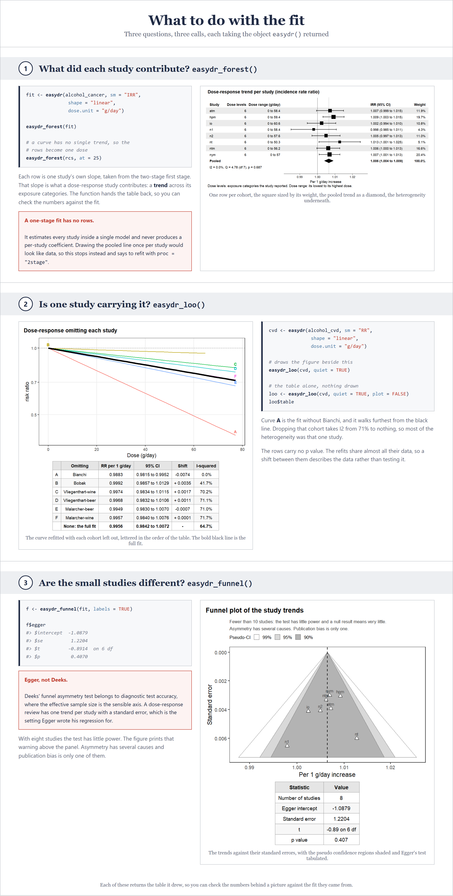

# easyDR

**Dose-response meta-analysis in one call, argued the way the `meta` package
argues. The book that teaches it is free.**

Sponsored by [Meta-Analysis Academy](https://metaanalysisacademy.com).

## Contents

| Section | Jump to |
|:---|:---|
| **[1 · The book](#1-the-book)**<br><sub>Free, six chapters, the whole method in the order of the work</sub> | [Read it](https://vanioljantunes.github.io/easyDR/) · [Chapters](#what-is-in-it) |
| **[2 · What this package is](#2-what-this-package-is)**<br><sub>One entry point, four things to do with what it returns</sub> | |
| **[3 · Install, data, and what <code>sm</code> decides](#3-install-data-and-what-sm-decides)**<br><sub>From a spreadsheet to a table easyDR reads</sub> | |
| **[4 · Fit it](#4-fit-it)**<br><sub><code>easydr()</code>, and why <code>shape</code> has no default</sub> | |
| **[5 · What to do with the fit](#5-what-to-do-with-the-fit)**<br><sub>Forest, leave-one-out, funnel</sub> | |
| **[6 · Validation](#6-validation-reproduce-a-published-analysis)**<br><sub>Paste it in, and check the numbers against this page</sub> | [Run it](#run-it) · [What you should see](#what-you-should-see) |

<sub>[References](#references) · [License](#license)</sub>

---

## 1. The book

The book in this repository teaches dose-response meta-analysis end to end,
and it is free to read:
**[open the book](https://vanioljantunes.github.io/easyDR/)**.

### What is in it

Six chapters, in the order the work actually happens:

| Chapter | What it covers |
|:---|:---|
| [Welcome](book/index.qmd) | What the book is for, and who it is for |
| [1 · What it is, goals and examples](book/01-what-is-it.qmd) | The question a dose-response answers, the five curve shapes, worked examples |
| [2 · Viability, search strategy and data extraction](book/02-viability.qmd) | Whether your studies can support one, and the extraction sheet that follows |
| [3 · Registering on PROSPERO and risk of bias](book/03-prospero.qmd) | The protocol, and appraising the studies you found |
| [4 · Statistics theory and code](book/04-statistics.qmd) | The two-stage and one-stage models, splines, and the R to fit them |
| [5 · Checklist, writing and interpretation](book/05-checklist-writing.qmd) | Reporting it, and what the curve does and does not license |

The source is in [`book/`](book) as Quarto files; `quarto render book` builds
it locally, after `R CMD INSTALL .` so the chunks can call the package.

---

## 2. What this package is


```r
library(easyDR)

fit <- easydr(alcohol_cancer, sm = "IRR", shape = "linear",
              dose.unit = "g/day", at = c(10, 25, 50))
fit                 # the whole answer, printed at once
fit$viability       # the check that runs before the model
fit$curve_label     # the name the curve earned: "monotonic increasing"
```

---

## 3. Install, data, and what `sm` decides


```r
# install.packages("remotes")
remotes::install_github("vanioljantunes/easyDR")
library(easyDR)

head(alcohol_cancer)   # a binary outcome, one row per intake category
head(aripiprazole)     # a continuous one: mean.e, sd.e, n.e
```

---

## 4. Fit it


```r
fit <- easydr(alcohol_cancer, sm = "IRR", shape = "linear",
              dose.unit = "g/day", at = c(10, 25, 50))

# shape has no default. Leave it out and the error lists what you may write:
# "linear", "log", "quadratic", "rcs", "fp".
easydr(alcohol_cancer, sm = "IRR")

# the curve, with every argument the picture used
easydr_curve(fit,
             main  = "Alcohol and colorectal cancer",
             xlab  = "Alcohol intake (g/day)",
             ylab  = "Rate ratio",
             ylim  = c(0.9, 1.8),
             round = 2,
             prediction = TRUE)
```

---

## 5. What to do with the fit



```r
cvd <- easydr(alcohol_cvd, sm = "RR", shape = "linear", dose.unit = "g/day")

# what each study contributed
easydr_forest(fit)
easydr_forest(rcs, at = 25)              # a curve has no single trend

# is one study carrying it
easydr_loo(cvd, quiet = TRUE)            # draws the curves and the table
easydr_loo(cvd, quiet = TRUE, plot = FALSE)$table   # the table alone

# are the small studies different
f <- easydr_funnel(fit, labels = TRUE)
f$egger
```

---

## 6. Validation: reproduce a published analysis

Everything above is a picture. This section is not. Paste it in and you should
get the numbers printed here, on your own machine.

The example is the one the book uses: eight prospective cohorts of alcohol
intake and colorectal cancer, analysed in Orsini et al. (2012) and bundled as
`alcohol_cancer`.

### Run it

```r
# install.packages("remotes")
remotes::install_github("vanioljantunes/easyDR")
library(easyDR)
```

**Step 1. Fit it. One call, and the whole answer prints.**

```r
fit <- easydr(alcohol_cancer, sm = "IRR", shape = "linear",
              dose.unit = "g/day", at = c(10, 25, 50))
fit
```

```text
Dose-response meta-analysis (incidence rate ratio)
Pooling: two-stage random effects, reml. Covariance: Greenland and Longnecker.

Per 1 g/day increase:  IRR 1.006  (95% CI 1.004 to 1.009)
Reference dose: 0 g/day
Curve shape: monotonic increasing

Departure from linearity: not estimable
  a linear fit has one term, so there is nothing to test it against
  8 of 8 studies have three or more dose levels

Heterogeneity: Q = 4.78 (df = 7), p = 0.687; I-squared = 0%

Predicted IRR
 dose (g/day) IRR       95% CI         95% PI
  0           reference reference      reference
 10           1.066     1.039 to 1.095 1.033 to 1.101
 25           1.175     1.099 to 1.255 1.084 to 1.272
 50           1.380     1.208 to 1.575 1.176 to 1.619

8 studies, 48 dose categories, dose range 0 to 60.6 g/day
Viability: 8 of 8 studies carry 3 or more dose levels.
Defaults applied:
  - intake: reported effect with limits, counts used for the covariance
```

No `formula` argument, and no `logrr` column. `sm = "IRR"` tells easyDR to
read the counts and the reported rate ratios, then derive the contrasts and
reconstruct the within-study covariances.

**Step 2. The pooled trend, to more digits.**

```r
round(c(slope = fit$slope$estimate, se = fit$slope$se), 7)
```

```text
    slope        se
0.0064373 0.0013521
```

That is the dose slope on the log scale, per gram per day. The model has no
intercept, because every contrast runs against the study's own reference
category.

**Step 3. Read it as rate ratios at intakes people recognise.**

```r
round(fit$predicted[, c("dose", "est", "ci.lb", "ci.ub")], 4)
```

```text
  dose    est  ci.lb  ci.ub
1    0 1.0000 1.0000 1.0000
2   10 1.0665 1.0386 1.0951
3   25 1.1746 1.0993 1.2551
4   50 1.3797 1.2085 1.5752
```

The reference dose stays in the table, because every one of those ratios is
measured against it.

**Step 4. What each cohort contributed.**

```r
f <- easydr_forest(fit)      # draws the forest, and returns its table
data.frame(study = f$table$study, round(f$table[, c("est", "se", "weight")], 5))
```

```text
  study      est      se   weight
1   atm  0.00714 0.00391 11.94346
2   hpm  0.00917 0.00304 19.73289
3    io  0.00236 0.00411 10.84301
4    n1 -0.00213 0.00654  4.27926
5    n2  0.00491 0.00407 11.02227
6    nt  0.01263 0.00600  5.08595
7   ntm  0.00613 0.00331 16.64675
8   nym  0.00688 0.00299 20.44642
```

Each plot returns the table it drew. These rows are the engine's own
first-stage estimates, so you can check them against the fit.

**Step 5. Small-study effects.**

```r
fn <- easydr_funnel(fit)
round(unlist(fn$egger[c("intercept", "se", "t", "p")]), 4)
```

```text
intercept        se         t         p
  -1.0879    1.2204   -0.8914    0.4070
```

Egger's regression. Deeks' test belongs to diagnostic test accuracy, so it
does not apply here. With eight studies Egger has little power, and the figure
prints that warning above the panel.

**Step 6. The two checks easyDR ran for you.**

```r
fit$curve_label
fit$viability
```

```text
[1] "monotonic increasing"
Dose-response viability

 study levels has_reference two_stage_ok
 atm   6      TRUE          TRUE
 hpm   6      TRUE          TRUE
 io    6      TRUE          TRUE
 n1    6      TRUE          TRUE
 n2    6      TRUE          TRUE
 nt    6      TRUE          TRUE
 ntm   6      TRUE          TRUE
 nym   6      TRUE          TRUE

No blocking problems found.
```

### What you should see

| Quantity | Value |
|---|---|
| Studies, exposure levels each | 8, 6 |
| Dose slope, log scale, per g/day | 0.0064373 |
| Standard error | 0.0013521 |
| Rate ratio at 10 g/day | 1.0665 (1.0386 to 1.0951) |
| Rate ratio at 25 g/day | 1.1746 (1.0993 to 1.2551) |
| Rate ratio at 50 g/day | 1.3797 (1.2085 to 1.5752) |
| Cochran Q | 4.78 on 7 df, p = 0.687 |
| I-squared | 0% |
| Largest contribution | nym, 20.4% |
| Egger intercept | -1.0879 (SE 1.2204), p = 0.407 |
| Curve shape | monotonic increasing |

Captured on R 4.6.0 with `dosresmeta` 2.2.0. A different BLAS or engine
version can move the last digit or two, but the rate ratios should agree to
three decimals. If they do not, something in your install differs, and the rest
of the book will differ with it. Worth finding out before you trust a curve of
your own.

---

## References

Greenland S, Longnecker MP (1992). Methods for trend estimation from summarized
dose-response data, with applications to meta-analysis. *American Journal of
Epidemiology* 135(11), 1301-1309.

Crippa A, Discacciati A, Bottai M, Spiegelman D, Orsini N (2019). One-stage
dose-response meta-analysis for aggregated data. *Statistical Methods in
Medical Research* 28(5), 1579-1596.

Orsini N, Li R, Wolk A, Khudyakov P, Spiegelman D (2012). Meta-analysis for
linear and nonlinear dose-response relations: examples, an evaluation of
approximations, and software. *American Journal of Epidemiology* 175(1), 66-73.

Crippa A, Orsini N (2016). Multivariate dose-response meta-analysis: the
dosresmeta R package. *Journal of Statistical Software* 72(1), 1-15.

Egger M, Davey Smith G, Schneider M, Minder C (1997). Bias in meta-analysis
detected by a simple, graphical test. *BMJ* 315(7109), 629-634.

The book's full bibliography is in [`book/references.bib`](book/references.bib).

---

## License

GPL-2 for the code in `R/`, `man/` and `tests/`. See [`LICENSE`](LICENSE).
easyDR imports `dosresmeta`, which is GPL-2, so easyDR has to be GPL-2 too.

CC BY-NC-SA 4.0 for the book text, figures and examples in `book/`. See
[`LICENSE-text.md`](LICENSE-text.md).

---

## Related

Part of the MetaRank 4 catalog from the [Meta-Analysis
Academy](https://metaanalysisacademy.com): one design, taught end to end, per
repo. The book is free. The video course, templates and support are the paid
half.

The four pictures above are built from [`tutorial/`](tutorial): `Rscript
tutorial/figures.R` draws the figures and captures the console blocks, then
`node tutorial/render.mjs <page>` for each of `overview`, `data`, `api` and
`plots`. The layout follows easyDTA, and the funnel follows `metafor`.

Questions and corrections:
[issues](https://github.com/vanioljantunes/easyDR/issues).
