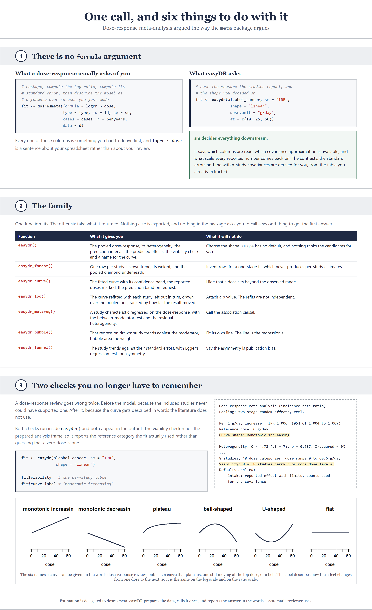
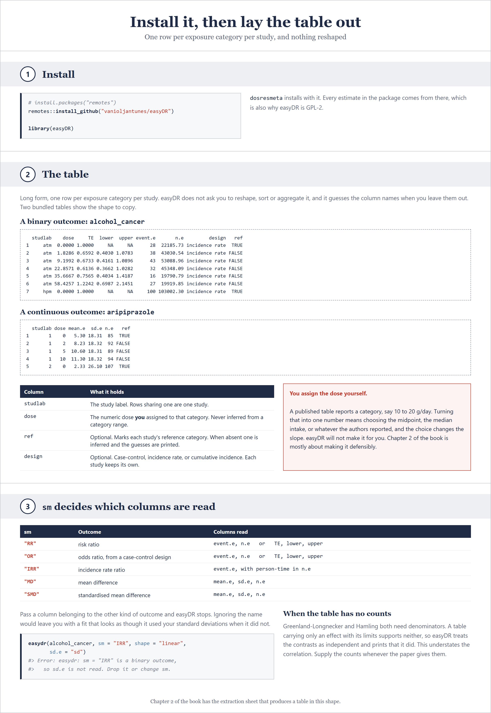
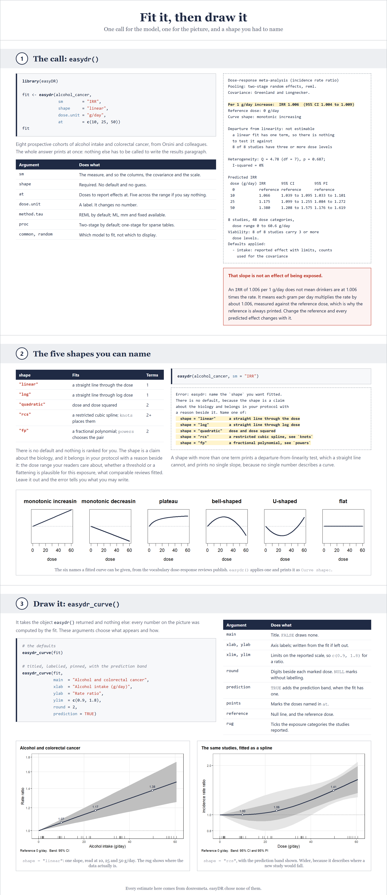
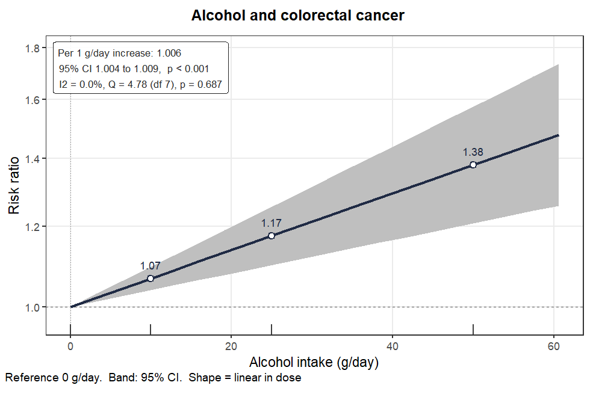
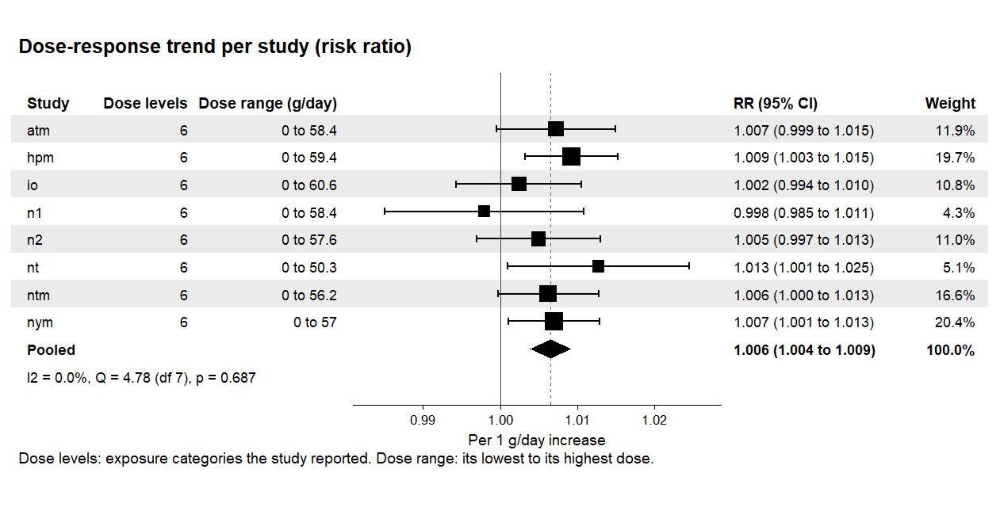
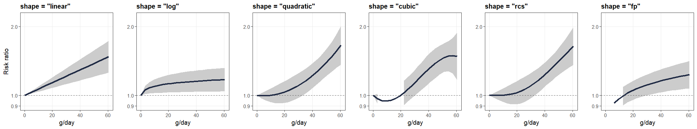
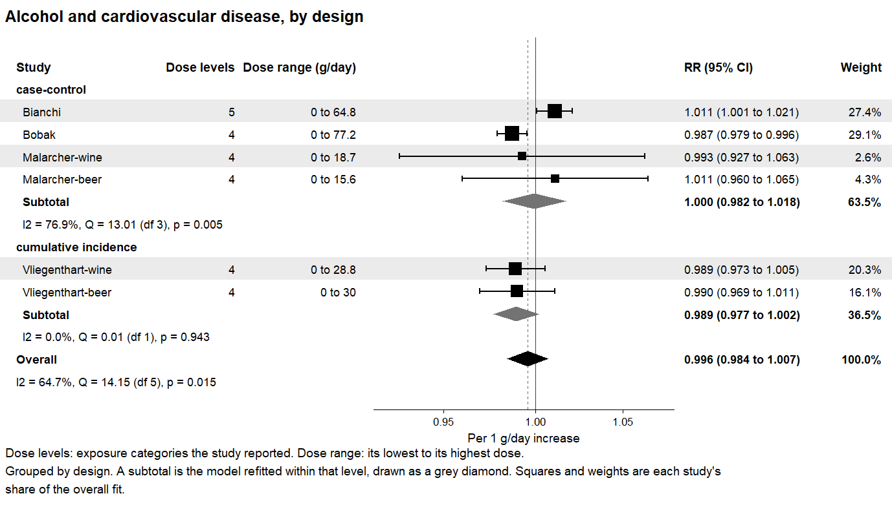
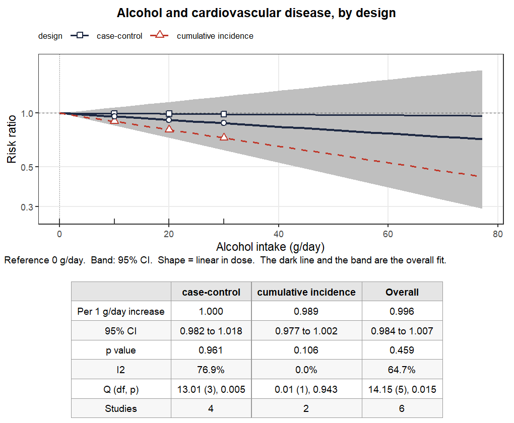
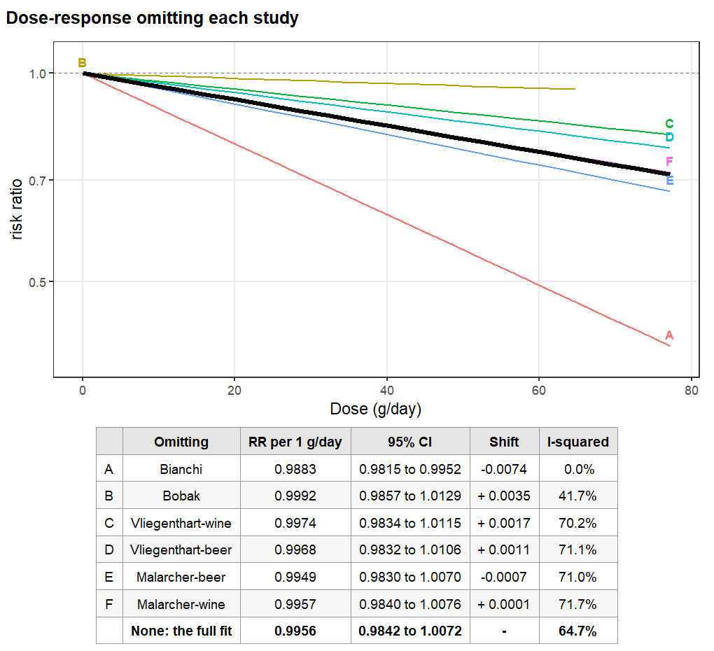
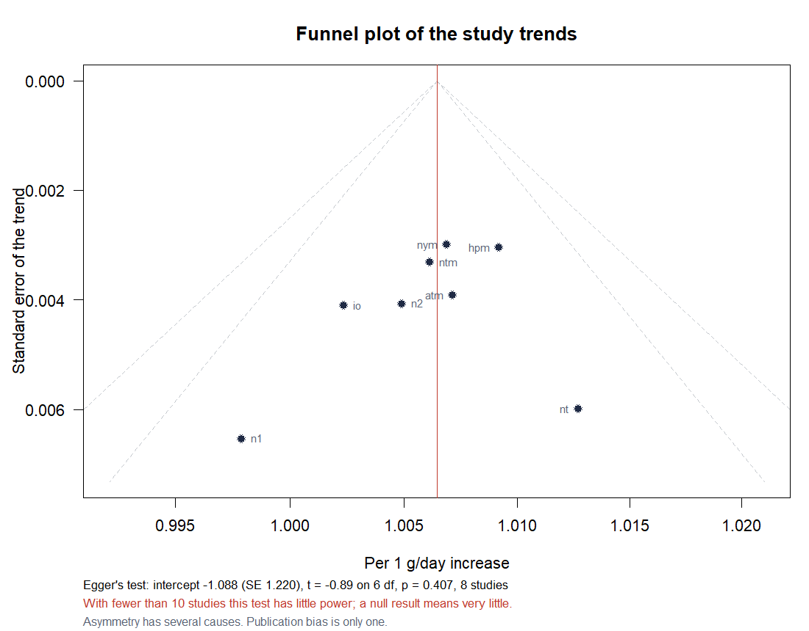

# easyDR

**Dose-response meta-analysis in one call, argued the way the `meta` package
argues. The book that teaches it is free.**

Sponsored by [Meta-Analysis Academy](https://metaanalysisacademy.com).

The book in this repository teaches dose-response meta-analysis end to end,
and it is free to read: **[open the book](https://vanioljantunes.github.io/easyDR/)**.
Its source is in [`book/`](book) as Quarto files.

## Contents

| Section | What it covers |
|:---|:---|
| **[1 . Install it, and what it does](#1-install-it-and-what-it-does)** | The one entry point, the four functions that take what it returns, and every main argument |
| **[2 . Prepare the data, then fit it](#2-prepare-the-data-then-fit-it)** | One row per exposure category, for binary and for continuous outcomes, then `easydr()`, `easydr_curve()` and `easydr_forest()`, and the five shapes fitted side by side |
| **[3 . Subgroups](#3-subgroups)** | One column name, and the model refitted inside each level, in the forest and in the curve |
| **[4 . Leave one out](#4-leave-one-out)** | Whether one study is carrying the result |
| **[5 . Publication bias](#5-publication-bias)** | The funnel plot, and Egger's test for small-study effects |
| **[6 . Validation](#6-validation)** | Reproduce a published analysis, and check your install against it |

<sub>[References](#references) . [License](#license)</sub>

---

## 1. Install it, and what it does



easyDR fits a **dose-response meta-analysis**: the question is not whether an
exposure has an effect, but how the effect changes as the dose rises. The
estimation is done by **{dosresmeta}** (Crippa and Orsini 2016), which easyDR
calls and never second-guesses.

You install it from GitHub, and you need nothing else.

<details>
<summary><b>Install easyDR</b>: <code>{r install}</code></summary>

```r
# Paste the whole block into R.
# install.packages("remotes")
remotes::install_github("vanioljantunes/easyDR")

library(easyDR)
```

</details>

There is one entry point, `easydr()`, and four functions that take what it
returns. You will recognise the arguments if you have used **{meta}**: `sm`,
`studlab`, `event.e`, `n.e`, `TE`, `lower`, `upper`, `method.tau`, `level`,
`common` and `random` mean here what they mean there. You write `sm = "RR"`
where another package would ask you for `formula = logrr ~ dose`, and easyDR
derives the contrasts, the standard errors and the within-study covariances
from your table.

| Function | What it answers | Main arguments |
|:---|:---|:---|
| `easydr()` | What is the dose-response? | `data`, `sm`, `shape`, `dose.unit`, `at`, `subgroup`, `method.tau`, `proc`, `common`, `random` |
| `easydr_curve()` | What does it look like? | `x`, `main`, `xlab`, `ylab`, `ylim`, `round`, `prediction`, `subgroup`, `result` |
| `easydr_forest()` | What did each study contribute? | `x`, `at`, `order`, `subgroup`, `columns`, `main`, `xlim` |
| `easydr_loo()` | Is one study carrying it? | `object`, `at`, `plot`, `quiet` |
| `easydr_funnel()` | Are the small studies different? | `x`, `at`, `labels`, `levels`, `shade` |

A few of those arguments decide more than the others, so they are worth
spelling out.

* **`sm`**. The summary measure: `"RR"`, `"OR"` or `"IRR"` for a binary
  outcome, `"MD"` or `"SMD"` for a continuous one. It decides which columns
  are read, how the within-study covariance is reconstructed, and whether the
  effect is drawn on a log axis.
* **`shape`**. The curve being fitted: `"linear"`, `"log"`, `"quadratic"`,
  `"rcs"` or `"fp"`. There is no default, and easyDR will not guess. The shape
  is a claim about the biology, and it belongs in your protocol with a reason
  beside it.
* **`at`**. The doses at which effects are reported. The curve marks them and
  ticks them on the axis. If you say nothing, five doses across the observed
  range are used.
* **`subgroup`**. The name of one column holding the subgroup each study
  belongs to. See Section 3.
* **`proc`**. `"2stage"` by default, which fits each study first and then pools
  the trends. `"1stage"` fits every study inside a single model, which helps
  when the table is sparse, but leaves no per-study estimate to draw.

Two checks run on your behalf, and both are folded into the fitted object.
The **viability** check runs before the model, and reports how many exposure
levels each study brought. The **curve label** is applied after it, and names
the fitted shape in the vocabulary dose-response reviews publish.

---

## 2. Prepare the data, then fit it

### One row per exposure category



easyDR reads a long table: **one row per exposure category per study**. The
reference category of each study stays in the table, because every effect that
study reported is measured against it. Which columns are read depends on `sm`.

For a **binary outcome**, you give the dose, the study label, the reported
effect with its confidence limits, and, where you have them, the counts.

| Column | Holds |
|:---|:---|
| `studlab` | the study label, repeated across its categories |
| `dose` | the dose assigned to that category |
| `TE`, `lower`, `upper` | the reported risk ratio and its confidence limits |
| `event.e`, `n.e` | cases and participants, or person-time for `sm = "IRR"` |
| `ref` | `TRUE` on the study's reference category |

For a **continuous outcome**, the effect columns are replaced by the group
summaries.

| Column | Holds |
|:---|:---|
| `studlab`, `dose`, `ref` | as above |
| `mean.e`, `sd.e`, `n.e` | the mean, the standard deviation and the sample size of that dose group |

Let us have a look at the two tables that ship with the package.

<details>
<summary><b>The two bundled tables</b>: <code>{r the-data}</code></summary>

```r
# Paste the whole block into R.
library(easyDR)

head(alcohol_cancer)   # binary: TE with limits, and counts
head(aripiprazole)     # continuous: mean.e, sd.e, n.e
```

</details>

Why the counts matter is worth one paragraph. A study does not report
independent effects. Every category is compared with the same reference
category, so the reference group's random error is shared by all of that
study's estimates. Treat them as independent, and the slope looks more certain
than it is. The counts are what let easyDR reconstruct that shared error, by
the method of Greenland and Longnecker (1992). This is the problem
dose-response meta-analysis exists to solve, and published reviews get it
wrong often.

### One call, and the whole answer

Time to put this into practice. The worked example is the one the book uses:
eight prospective cohorts of alcohol intake and colorectal cancer, analysed in
Orsini and colleagues (2012) and bundled as `alcohol_cancer`.



<details>
<summary><b>Fit it, then draw it</b>: <code>{r fit-and-draw}</code></summary>

```r
# Paste the whole block into R.
library(easyDR)

# at = names the doses to report effects at. The curve marks and ticks them.
fit <- easydr(alcohol_cancer, sm = "RR", shape = "linear",
              dose.unit = "g/day", at = c(10, 25, 50))
fit

# shape has no default. Leave it out and the error lists what you may write.
try(easydr(alcohol_cancer, sm = "RR"))

# the whole fit as a figure
easydr_curve(fit,
             main  = "Alcohol and colorectal cancer",
             xlab  = "Alcohol intake (g/day)",
             ylab  = "Risk ratio",
             round = 2)

# what each study contributed
easydr_forest(fit)
```

</details>

We see that the pooled trend is a risk ratio of 1.006 per 1 g/day, with a 95%
confidence interval from 1.004 to 1.009, and that the heterogeneity is
$I^2$ = 0%. A trend of 1.006 per gram does not mean that drinkers run 1.006
times the risk. It means that each gram per day multiplies the risk by about
1.006, measured against the reference dose, which is why easyDR prints that
reference every time. Read at intakes people recognise, the same fit gives
1.07 at 10 g/day, 1.17 at 25 g/day and 1.38 at 50 g/day.



The summary table under the figure carries the effect, its interval, its p
value, the heterogeneity and the number of studies, so we can read the picture
without the printout beside it.

Let us now look at the other half of the story. The forest gives one row per
study, with its own trend, a confidence interval, and the weight it carried.



A dose-response study contributes a **trend**, not an effect, and that is what
a row shows: the study's own slope per unit of dose, taken from the two-stage
first stage. A shape with more than one term has no single slope, so the rows
become the predicted effect at one dose, and `at` chooses which.

### The five shapes, fitted

The `shape` argument is the one decision easyDR refuses to make for you. Here
are all five, fitted to the same eight cohorts, on the same axes.



<details>
<summary><b>Every shape on the same data</b>: <code>{r the-five-shapes}</code></summary>

```r
# Paste the whole block into R.
library(easyDR)

for (s in c("linear", "log", "quadratic", "rcs", "fp")) {
  f <- easydr(alcohol_cancer, sm = "RR", shape = s, dose.unit = "g/day")
  print(f)
  easydr_curve(f, main = paste0("shape = ", s), result = FALSE)
}
```

</details>

We see that the straight line and the spline tell a similar story here, that
the log curve rises steeply and then flattens, and that `"log"` and `"fp"`
start away from zero, because the logarithm of a zero dose is undefined. A
shape with more than one term also prints a departure-from-linearity test,
which a straight line cannot, and prints no single slope, because no single
number describes a curve.

Which one should you fit? Fit the one your protocol names, for the reason your
protocol gives: the dose range your readers care about, whether a threshold or
a flattening is plausible for this exposure, and what comparable reviews
fitted. Choosing the shape after seeing five fits is a "researcher degree of
freedom", and it is the reason easyDR has no default and ranks nothing.

---

## 3. Subgroups

Often we want to know not only what the dose-response is, but whether it is
the same in studies of different kinds. We pass `subgroup` the name of one
column, and easyDR fits the whole model again inside each level of it.

Each level inherits everything: the shape as a resolved object with its fitted
knots, the pooling stage, the covariance approximation, and the columns by the
name the first fit resolved. A level therefore differs from the overall fit
only in which studies it contains, and each level keeps its own between-study
variance.

> **A subgroup is a characteristic of a study**
>
> The column must take one value per study. A column that changes between the
> dose categories of the same study describes the categories, not the studies,
> and easyDR refuses it rather than quietly fitting something else. A column
> with the same value everywhere splits nothing, and is refused for the same
> reason.

Let us try this on `alcohol_cvd`, where the `design` column separates four
case-control cohorts from two with cumulative incidence.

<details>
<summary><b>Subgroups in the forest and in the curve</b>: <code>{r subgroups}</code></summary>

```r
# Paste the whole block into R.
library(easyDR)

sub <- easydr(alcohol_cvd, sm = "RR", shape = "linear", dose.unit = "g/day",
              at = c(10, 20, 30), subgroup = "design")
sub

# grouped by default, when the fit carries a subgroup
easydr_forest(sub, main = "Alcohol and cardiovascular disease, by design")
easydr_curve(sub, main = "Alcohol and cardiovascular disease, by design",
             xlab = "Alcohol intake (g/day)", ylab = "Risk ratio")

# the overall fit on its own
easydr_forest(sub, subgroup = FALSE)
easydr_curve(sub, subgroup = FALSE)

# why a level could not be fitted, if one could not
sub$subgroup$table
```

</details>

Let us go through the forest first. It groups the rows the way **{meta}**
does. A block is headed by the
level on its own, never by the column name, and is closed by a **subtotal**:
the model refitted within that level, drawn as a grey diamond, with its own
heterogeneity beneath it. The black diamond at the foot is the overall fit.



We see that the four case-control cohorts give a subtotal of 1.000, from 0.982
to 1.018, with $I^2$ = 76.9%, and that the two cumulative incidence cohorts
give 0.989, from 0.977 to 1.002, with $I^2$ = 0%. The squares and the weights
stay each study's share of the overall fit, so they still sum to 100% down the
page.

In the curve, each level gets its own line, told apart twice over: by colour
and by line type, because colour alone is lost in print and to a colour-blind
reader. Its marked doses get their own shape. The band stays the overall one,
since a ribbon per level turns the panel to mud as soon as there are three.



The table under the figure gains one column per level and ends with the
overall fit, so we can read the levels side by side.

easyDR reports no test for a difference between the levels. Two subgroups
estimated from four studies and from two will differ by some amount whatever
the truth is, and a p value printed beside them invites a claim the data
cannot carry. We read the intervals instead, we say how far they overlap, and
we say how few studies each one rests on.

---

## 4. Leave one out

A pooled result that depends on one study is worth knowing about before it
reaches a reviewer. Let us refit the model with each study left out in turn.
`easydr_loo()` does this, inheriting the model exactly as a subgroup level
does, and orders the rows by how far the estimate moved.

<details>
<summary><b>Leave one out</b>: <code>{r leave-one-out}</code></summary>

```r
# Paste the whole block into R.
library(easyDR)

cvd <- easydr(alcohol_cvd, sm = "RR", shape = "linear", dose.unit = "g/day")

easydr_loo(cvd, quiet = TRUE)                       # the figure and the table
easydr_loo(cvd, quiet = TRUE, plot = FALSE)$table   # the table alone
```

</details>



```text
Leave-one-out sensitivity (risk ratio)
6 refits, 6 fitted, 0 failed, 0.3 seconds
Inherited: linear in dose; two-stage reml; reference 0 g/day
Ordered by the absolute shift in the slope, RR per 1 g/day. Full fit: 0.9956

 omitted           n RR     95% CI           shift   I-squared
 Bianchi           5 0.9883 0.9815 to 0.9952 -0.0074  0.0%
 Bobak             5 0.9992 0.9857 to 1.0129 +0.0035 41.7%
 Vliegenthart-wine 5 0.9974 0.9834 to 1.0115 +0.0017 70.2%
 Vliegenthart-beer 5 0.9968 0.9832 to 1.0106 +0.0011 71.1%
 Malarcher-beer    5 0.9949 0.9830 to 1.0070 -0.0007 71.0%
 Malarcher-wine    5 0.9957 0.9840 to 1.0076 +0.0001 71.7%
```

We see that dropping Bianchi moves the slope furthest, and that it takes the
heterogeneity from about 72% to 0%. Most of the disagreement in this analysis
was that one cohort. On the figure, the curve fitted without Bianchi is the one
that walks furthest from the bold black line of the full fit.

The rows carry no p value, and that is deliberate. The refits share almost all
of their data, so a shift between them describes what we have rather than
testing anything about it.

---

## 5. Publication bias

A funnel plot asks whether the small studies sit away from the pooled value.
Let us draw one. `easydr_funnel()` shades the pseudo confidence regions the way
`metafor::funnel()` shades them, and prints **Egger's regression test** (Egger
and colleagues 1997) in a table underneath.

<details>
<summary><b>The funnel, and Egger's test</b>: <code>{r funnel}</code></summary>

```r
# Paste the whole block into R.
library(easyDR)

fit <- easydr(alcohol_cancer, sm = "RR", shape = "linear",
              dose.unit = "g/day")

f <- easydr_funnel(fit, labels = TRUE)
f$egger
```

</details>



```text
Egger's test for small-study effects
  intercept -1.0879 (SE 1.2204)
  t = -0.89 on 6 df, p = 0.407
  8 studies: fewer than 10, so the test has little power and a null result means very little
```

We see that the intercept is -1.09, with a p value of 0.407, on eight studies.
Why Egger, and not Deeks? Deeks' funnel plot asymmetry test belongs to
diagnostic test accuracy, where the effective sample size rather than the
standard error is the sensible horizontal axis. It does not apply here. A
dose-response review has one trend estimate per study with a standard error,
which is the setting Egger wrote his regression for: regress each study's
standard normal deviate on its precision, and read the intercept.

> **Asymmetry has several causes, and publication bias is only one**
>
> A funnel plot cannot say why the small studies sit where they do.
> Publication bias produces that pattern, and so do real differences between
> small and large studies, poorer methods in the smaller ones, and chance.
> Below about ten studies the test has little power, and a null result means
> almost nothing (Sterne and colleagues 2011). The figure prints that warning
> above its panel rather than leaving it to be remembered.

---

## 6. Validation

Everything above is a picture of what easyDR does. This section is not. Run the
script, and you should get the values printed below, on your own machine.

Paste it into a fresh _R_ session, or run it from the package root with
`Rscript validation/reproduce.R`. It needs easyDR and nothing else: no data
files, and it runs in a couple of seconds.

<details>
<summary><b>The whole analysis</b>: <code>validation/reproduce.R</code></summary>

```r
# easyDR: reproduce the published alcohol and colorectal cancer analysis.
# Eight prospective cohorts, analysed in Orsini et al. (2012) and bundled as
# alcohol_cancer. Paste the whole file into R; no data files are needed.
# install.packages("remotes"); remotes::install_github("vanioljantunes/easyDR")

library(easyDR)

# One call. No formula argument and no logrr column: sm = "RR" tells easyDR to
# read the counts and the reported risk ratios, derive the contrasts, and
# reconstruct the within-study covariances.
fit <- easydr(alcohol_cancer, sm = "RR", shape = "linear",
              dose.unit = "g/day", at = c(10, 25, 50))
fit

# The coefficient on the log scale, the goodness of fit, and what each cohort
# contributed. This is the number to quote in a methods section.
summary(fit)

# The rows behind the forest plot, with weights. The figure is drawn and the
# table prints itself; the stored values keep full precision.
easydr_forest(fit)$table

# Small-study effects. Egger's regression, printed as a test result with its
# power warning. Deeks' test belongs to diagnostic test accuracy.
easydr_funnel(fit)$egger

# The two checks easyDR ran before and after the model.
fit$curve_label
fit$viability

# The curve, with every argument the README figure used.
easydr_curve(fit,
             main  = "Alcohol and colorectal cancer",
             xlab  = "Alcohol intake (g/day)",
             ylab  = "Risk ratio",
             round = 2)
```

</details>

### What you should see

| Quantity | Value |
|---|---|
| Studies, exposure levels each | 8, 6 |
| Dose slope, log scale, per g/day | 0.0064373 |
| Standard error | 0.0013521 |
| Risk ratio at 10 g/day | 1.0665 (1.0386 to 1.0951) |
| Risk ratio at 25 g/day | 1.1746 (1.0993 to 1.2551) |
| Risk ratio at 50 g/day | 1.3797 (1.2085 to 1.5752) |
| Cochran Q | 4.78 on 7 df, p = 0.687 |
| I-squared | 0% |
| Largest contribution | nym, 20.4% |
| Egger intercept | -1.0879 (SE 1.2204), p = 0.407 |
| Curve shape | monotonic increasing |

Captured on _R_ 4.6.0 with **{dosresmeta}** 2.2.0. A different BLAS or engine
version can move the last digit or two, but the risk ratios should agree to
three decimals. If they do not, something in your install differs, and the rest
of the book will differ with it. That is worth finding out before you trust a
curve of your own.

---

## References

Greenland S, Longnecker MP (1992). Methods for trend estimation from summarized
dose-response data, with applications to meta-analysis. *American Journal of
Epidemiology* 135(11), 1301-1309.

Crippa A, Discacciati A, Bottai M, Spiegelman D, Orsini N (2019). One-stage
dose-response meta-analysis for aggregated data. *Statistical Methods in
Medical Research* 28(5), 1579-1596.

Orsini N, Li R, Wolk A, Khudyakov P, Spiegelman D (2012). Meta-analysis for
linear and nonlinear dose-response relations: examples, an evaluation of
approximations, and software. *American Journal of Epidemiology* 175(1), 66-73.

Crippa A, Orsini N (2016). Multivariate dose-response meta-analysis: the
dosresmeta R package. *Journal of Statistical Software* 72(1), 1-15.

Egger M, Davey Smith G, Schneider M, Minder C (1997). Bias in meta-analysis
detected by a simple, graphical test. *BMJ* 315(7109), 629-634.

Sterne JAC, Sutton AJ, Ioannidis JPA, et al. (2011). Recommendations for
examining and interpreting funnel plot asymmetry in meta-analyses of
randomised controlled trials. *BMJ* 343, d4002.

Viechtbauer W (2010). Conducting meta-analyses in R with the metafor package.
*Journal of Statistical Software* 36(3), 1-48.

Balduzzi S, Rucker G, Schwarzer G (2019). How to perform a meta-analysis with
R: a practical tutorial. *Evidence-Based Mental Health* 22(4), 153-160.

The book's full bibliography is in [`book/references.bib`](book/references.bib).

---

## License

GPL-2 for the code in `R/`, `man/` and `tests/`. See [`LICENSE`](LICENSE).
easyDR imports `dosresmeta`, which is GPL-2, so easyDR has to be GPL-2 too.

CC BY-NC-SA 4.0 for the book text, figures and examples in `book/`. See
[`LICENSE-text.md`](LICENSE-text.md).

---

## Related

Part of the MetaRank 4 catalog from the [Meta-Analysis
Academy](https://metaanalysisacademy.com): one design, taught end to end, per
repo. The book is free. The video course, templates and support are the paid
half.

The figures are built from [`tutorial/`](tutorial). `Rscript
tutorial/figures.R` draws every plot and captures the console blocks, and
`node tutorial/render.mjs <page>` renders the three infographic pages used
above, `overview`, `data` and `api`. A fourth page, `plots`, is still in the
folder but is no longer embedded here: what it covered now lives in Sections
2, 4 and 5. The forest layout follows easyDTA, and the funnel follows
**{metafor}**.

Questions and corrections:
[issues](https://github.com/vanioljantunes/easyDR/issues).
