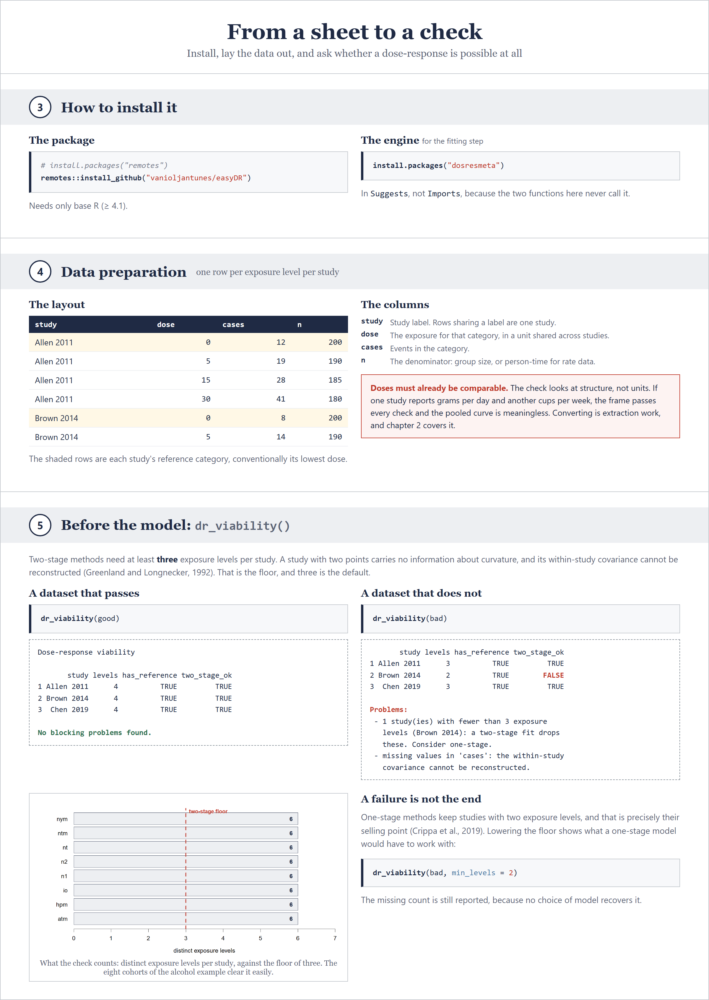
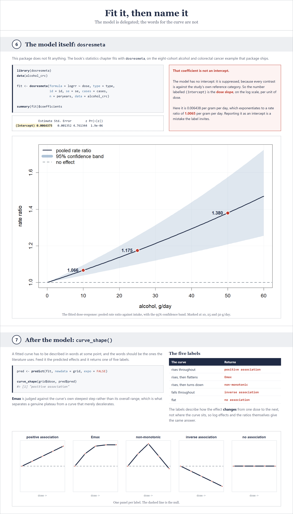

# easyDR

**Dose-response meta-analysis, made teachable: a free book, and the two checks
that belong either side of the model.**

Sponsored by [Meta-Analysis Academy](https://metaanalysisacademy.com).

## Contents

| Section | Jump to |
|:---|:---|
| **[1 · The book](#1-the-book)**<br><sub>Free, six chapters, the whole method in the order of the work</sub> | [Read it](https://vanioljantunes.github.io/easyDR/) · [Chapters](#what-is-in-it) |
| **[2 · What this package is](#2-what-this-package-is)**<br><sub>Two functions, and why it is only two</sub> | |
| **[3 to 5 · Install, data, and the check](#3-to-5-install-data-and-the-viability-check)**<br><sub>From a sheet to <code>dr_viability()</code></sub> | |
| **[6 and 7 · Fit it, then name it](#6-and-7-fit-the-model-then-name-the-curve)**<br><sub>dosresmeta, then <code>curve_shape()</code></sub> | |
| **[8 · Validation](#8-validation-reproduce-a-published-analysis)**<br><sub>Paste it in, and check the numbers against this page</sub> | [Run it](#run-it) · [What you should see](#what-you-should-see) |

<sub>[References](#references) · [License](#license)</sub>

---

## 1. The book

This repository holds a book that teaches dose-response meta-analysis end to
end, free to read:
**[open the book](https://vanioljantunes.github.io/easyDR/)**.

### What is in it

Six chapters, in the order the work actually happens:

| Chapter | What it covers |
|:---|:---|
| [Welcome](book/index.qmd) | What the book is for, and who it is for |
| [1 · What it is, goals and examples](book/01-what-is-it.qmd) | The question a dose-response answers, the five curve shapes, worked examples |
| [2 · Viability, search strategy and data extraction](book/02-viability.qmd) | Whether your studies can support one, and the extraction sheet that follows |
| [3 · Registering on PROSPERO and risk of bias](book/03-prospero.qmd) | The protocol, and appraising the studies you found |
| [4 · Statistics theory and code](book/04-statistics.qmd) | The two-stage and one-stage models, splines, and the R to fit them |
| [5 · Checklist, writing and interpretation](book/05-checklist-writing.qmd) | Reporting it, and what the curve does and does not license |

The source is in [`book/`](book) as Quarto files; `quarto render book` builds
it locally, after `R CMD INSTALL .` so the chunks can call the package.

---

## 2. What this package is


---

## 3 to 5. Install, data, and the viability check



---

## 6 and 7. Fit the model, then name the curve



---

## 8. Validation: reproduce a published analysis

The pages above are pictures. This section is not: paste it in and you should
get the numbers printed here, on your own machine.

The example is the one `dosresmeta` ships and the book uses: eight prospective
cohorts of alcohol intake and colorectal cancer, analysed in Orsini et al.
(2012).

### Run it

```r
install.packages("dosresmeta")
# install.packages("remotes")
remotes::install_github("vanioljantunes/easyDR")
```

**Step 1. Can these studies support a dose-response at all?**

```r
library(easyDR)
library(dosresmeta)
data(alcohol_crc)

dr_viability(alcohol_crc, study = "id", dose = "dose",
             cases = "cases", n = "peryears")
```

```text
Dose-response viability

  study levels has_reference two_stage_ok
1   atm      6          TRUE         TRUE
2   hpm      6          TRUE         TRUE
3    io      6          TRUE         TRUE
4    n1      6          TRUE         TRUE
5    n2      6          TRUE         TRUE
6    nt      6          TRUE         TRUE
7   ntm      6          TRUE         TRUE
8   nym      6          TRUE         TRUE

No blocking problems found.
```

Eight studies, six exposure levels each, every one clearing the floor of three.

**Step 2. Fit it.**

```r
fit <- dosresmeta(formula = logrr ~ dose, type = type, id = id,
                  se = se, cases = cases, n = peryears,
                  data = alcohol_crc)

round(summary(fit)$coefficients, 7)
```

```text
             Estimate Std. Error        z Pr(>|z|)  95%ci.lb  95%ci.ub
(Intercept) 0.0064375   0.001352 4.761344  1.9e-06 0.0037876 0.0090875
```

Remember what that row is: the dose slope on the log scale, not an intercept.

**Step 3. Read it as rate ratios at intakes people recognise.**

```r
grid <- data.frame(dose = c(0, 10, 25, 50))
pred <- predict(fit, newdata = grid, expo = TRUE)
round(pred, 4)
```

```text
  dose   pred  ci.lb  ci.ub
1    0 1.0000 1.0000 1.0000
2   10 1.0665 1.0386 1.0951
3   25 1.1746 1.0993 1.2551
4   50 1.3797 1.2085 1.5752
```

Keep the reference dose in `newdata`. Without the `0` row, `predict()` treats
the first row as the reference and every ratio comes out relative to 10 g/day
instead of to no intake.

**Step 4. Heterogeneity.**

```r
q <- summary(fit)$qstat
data.frame(Q = round(unname(q$Q), 4), df = unname(q$df),
           p = round(unname(q$pvalue), 4))
```

```text
       Q df      p
1 4.7797  7 0.6868
```

**Step 5. Name the curve.**

```r
curve_grid <- data.frame(dose = seq(0, 60, by = 10))
curve_pred <- predict(fit, newdata = curve_grid, expo = FALSE)

curve_shape(curve_grid$dose, curve_pred$pred)
```

```text
[1] "positive association"
```

### What you should see

| Quantity | Value |
|---|---|
| Studies, exposure levels each | 8, 6 |
| Dose slope, log scale, per g/day | 0.0064375 |
| Standard error | 0.0013520 |
| Rate ratio at 10 g/day | 1.0665 (1.0386 to 1.0951) |
| Rate ratio at 25 g/day | 1.1746 (1.0993 to 1.2551) |
| Rate ratio at 50 g/day | 1.3797 (1.2085 to 1.5752) |
| Cochran Q | 4.7797 on 7 df, p = 0.6868 |
| Curve shape | positive association |

Captured on R 4.6.0 with `dosresmeta` 2.2.0. The last digit or two can move
with a different BLAS or engine version; the rate ratios should agree to three
decimals. If they do not, something in your install differs, and the rest of
the book will differ with it, so it is worth finding out before you trust a
curve of your own.

---

## References

Greenland S, Longnecker MP (1992). Methods for trend estimation from summarized
dose-response data, with applications to meta-analysis. *American Journal of
Epidemiology* 135(11), 1301-1309.

Crippa A, Discacciati A, Bottai M, Spiegelman D, Orsini N (2019). One-stage
dose-response meta-analysis for aggregated data. *Statistical Methods in
Medical Research* 28(5), 1579-1596.

Orsini N, Li R, Wolk A, Khudyakov P, Spiegelman D (2012). Meta-analysis for
linear and nonlinear dose-response relations: examples, an evaluation of
approximations, and software. *American Journal of Epidemiology* 175(1), 66-73.

Crippa A, Orsini N (2016). Multivariate dose-response meta-analysis: the
dosresmeta R package. *Journal of Statistical Software* 72(1), 1-15.

The book's full bibliography is in [`book/references.bib`](book/references.bib).

---

## License

MIT for the code in `R/`, `man/` and `tests/`. See [`LICENSE`](LICENSE).

CC BY-NC-SA 4.0 for the book text, figures and examples in `book/`. See
[`LICENSE-text.md`](LICENSE-text.md).

---

## Related

Part of the MetaRank 4 catalog from the [Meta-Analysis
Academy](https://metaanalysisacademy.com): one design, taught end to end, per
repo. The book is free. The video course, templates and support are the paid
half.

The three pictures above are built from [`tutorial/`](tutorial): `Rscript
tutorial/plot.R` for the figures, then `node tutorial/render.mjs <page>` for
each of `overview`, `workflow` and `curve`.

Questions and corrections:
[issues](https://github.com/vanioljantunes/easyDR/issues).
