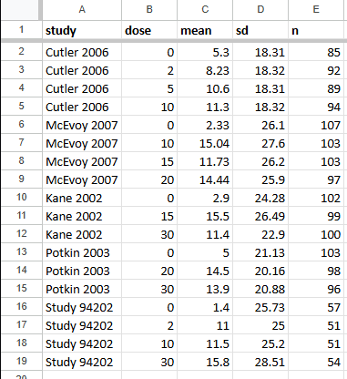
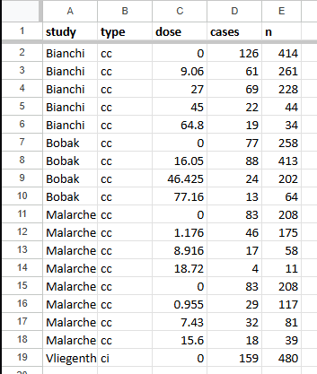

# Viability, search strategy and data extraction {#sec-viability}

```{r}
#| include: false
library(easyDR)
knitr::opts_chunk$set(collapse = FALSE, comment = "")
# Measured, not guessed: the output column fits 69 monospace characters at
# this font size. R gets a little less than that so nothing reaches the edge,
# and R wraps its own columns, which keeps them aligned. Never let CSS wrap
# this text: alignment is the information.
options(width = 66)
```

By now we know what a dose-response meta-analysis answers and what shapes a
curve can take. That was Chapter 1, and it was entirely about the question. This
chapter is about whether the literature will let us ask it.

Most dose-response meta-analyses fail here rather than at the model. The model
is a solved problem, and good software will fit something to almost anything we
hand it. The hard part comes earlier: finding enough studies that report enough
dose levels in enough detail, and noticing that we do not have them before we
have spent three months extracting. In Chapter 1 we promised a checklist. Here
we turn it into five steps we can run against a real extraction sheet, and we
run them twice, once on continuous data and once on binary data.

We will use the two data sets that sit inside **{easyDR}**, both of them the
ones used in the class.

::: {.callout-note appearance="simple"}
**The data sets in this chapter**

`aripiprazole` holds five fixed-dose trials of aripiprazole in schizophrenia,
with the change in the Positive and Negative Syndrome Scale reported as a mean
and a standard deviation per dose arm. It is the data behind Crippa and Orsini
[-@crippa2016].

`alcohol_cvd` holds six contrasts from four studies of alcohol intake and
cardiovascular disease, reported as an effect with confidence limits plus the
cases and totals per category.

Both come with the package, so `library(easyDR)` is all that is needed:

```{r}
library(easyDR)
```
:::

## Assessing viability

A dose-response meta-analysis is **viable** when the published literature
contains enough structured information to estimate a trend, not merely to
compare a high group against a low group. That is a stronger requirement than an
ordinary meta-analysis makes, and it is worth being precise about it before any
screening begins.

In Chapter 1 we met the three conditions informally. Let us restate them as
something we can check, and add the two that only reveal themselves once the
extraction sheet exists. Five steps, and we will run each one on both examples
as we go.

### Step 1. At least three studies asking the same question

Three studies, assessing the same intervention or exposure, in the same
population, against the same outcome. Below three, the between-study variance
cannot be estimated with any honesty, and the pooled curve is an expensive way
of drawing one study.

Let us see what the two examples hold.

```{r}
unique(aripiprazole$studlab)
```

Five trials. The labels are numbers here because the source data set identifies
trials by index; in our own work we would use author and year.

```{r}
unique(alcohol_cvd$studlab)
```

Six labels, and this is the first place where judgement is needed rather than
arithmetic. Malarcher and Vliegenthart each appear twice, once for beer and once
for wine. Those are not six independent studies. They are four studies, two of
which contribute two separate exposure contrasts.

We treat them as separate rows because beer and wine are different exposures
with different dose scales, and pooling them inside a study would destroy the
dose information we came for. We must also remember that the two rows from one
cohort share participants, so they are not independent, and we say so in the
limitations. Both examples clear Step 1, but only one of them clears it without
a sentence of explanation.

::: {.callout-important}
**One study, several contrasts**

A single cohort reporting several exposures, several outcomes, or several
subgroups will often enter the sheet more than once. Counting those rows as
separate studies inflates the apparent evidence. Count **papers** for Step 1,
count **contrasts** for the model, and state the difference in the methods.
:::

### Step 2. At least three dose levels per study

This is the condition that separates a dose-response review from every other
kind. A study with two exposure groups can tell us whether high differs from
low. It cannot tell us the shape of anything, because two points define a line
and leave nothing over to test it with.

Three levels is the conventional floor for the two-stage approach we will meet
in Chapter 4, and **{easyDR}** uses it as the default.

Counting them is worth writing out rather than hiding in a function, because
it is what we would check in a spreadsheet anyway. The same four lines answer
Step 3 as well, so we write them once:

```{r}
viability <- function(data) {
  s <- factor(data$studlab)
  data.frame(
    levels     = as.vector(table(s)),
    references = as.vector(table(s, data$ref)[, "TRUE"]),
    row.names  = levels(s)
  )
}

viability(aripiprazole)
```

Three of the trials report four dose arms and two report three, so every trial
clears the floor. The same check on the binary example:

```{r}
viability(alcohol_cvd)
```

Bianchi reports five categories and the rest report four. Both examples pass,
which is not the usual experience: in most searches this is the step that
removes half the hits.

::: {.callout-important}
**Two levels is not a reason to exclude, yet**

A study with two levels cannot carry a trend in a two-stage model, but it can
still enter a highest-against-lowest comparison, and a one-stage model can use
it. The decision is about which analysis the study belongs to, not about whether
it belongs in the review. Say which analyses each study is in.
:::

### Step 3. A usable reference level in every study

Every study needs one level that the others are expressed against. It is often
placebo or never-exposed, and it does not have to be. The lowest dose a study
reports will serve, as long as we are consistent and say what we did.

What matters is that the reference exists and that there is exactly one of it.
In the packaged data this is the `ref` column, and the `references` column of
the frame we just built counts it: one apiece, in both examples.

When studies disagree about what the reference
should be, and they usually do, the estimates have to be re-expressed against a
common reference before pooling [@hamling2008]. That is a Chapter 4 problem; at
this stage we only need to know that a reference exists.

### Step 4. Enough reported per level to reconstruct the covariance

Here is the step that is invisible until we try to extract, and it is the one
that sinks most reviews.

The levels within a study are all compared against the same reference, so their
effects are correlated. Treating them as independent would give a confidence
interval that is too narrow, so the within-study covariance has to be
reconstructed. Doing that needs more than the effect estimate: it needs the
counts, or the means with their standard deviations, behind each level
[@greenland1992].

For continuous data we need a mean, a standard deviation and an n per level:

```{r}
head(aripiprazole, 4)
```

`mean.e`, `sd.e` and `n.e` are all present, so the continuous example is
complete.

For binary data we need the effect with its limits, and the cases and totals:

```{r}
head(alcohol_cvd, 4)
```

`TE` with `lower` and `upper`, then `event.e` and `n.e`. Note that the reference
row carries `TE = 1` and no limits, which is correct: the reference is the
comparator, not an estimate.

::: {.callout-important}
**The step that ends reviews**

A paper may report a beautiful table of odds ratios per quintile and never print
the number of cases in each quintile. Without the counts, the covariance cannot
be reconstructed, and the study cannot enter a two-stage model.

This chapter lost an example to exactly this. The class used Furukawa and
colleagues [-@furukawa2019] as its binary illustration. That paper pools 77
trials, and its supplementary appendix lists, for every treatment arm, the drug,
the dose delivered and the number randomised. It never lists how many of them
responded. The dose is there, the denominator is there, and the numerator is
not, so no amount of care at the extraction stage can rescue it.

Check this on three or four candidate papers before committing to a question.
:::

### Step 5. Extract, and fit something

The final check is empirical. A sheet that passes the first four steps on paper
may still fail when a model touches it, usually because of a dose that does not
increase, a duplicated reference, or a level with an impossible standard
deviation.

Now we fit. The point of fitting here is not to learn anything about alcohol or
about aripiprazole. It is to confirm that the data can carry a model at all.

```{r}
fit_c <- easydr(aripiprazole, sm = "MD", shape = "linear")
fit_c
```

There is a lot in that output, and almost all of it belongs to Chapter 4. For
now we read only the last lines: **5 studies, 18 dose categories**, and a
viability line confirming that five of five trials carry three or more levels.
The estimate is finite and its interval is usable. The data carries a model.

```{r}
fit_b <- easydr(alcohol_cvd, sm = "OR", shape = "linear")
fit_b
```

Again, **6 studies, 25 dose categories**, a finite estimate and a usable
interval. We see the same structure as before, on data of a different kind. We also see a note that the designs differ across the included
studies, four case-control and two cumulative incidence, and that each study
keeps its own covariance approximation. That is a limitation to carry forward,
not a failure.

Notice what the package did not do. It refused to choose a shape for us: asking
for a fit without naming `shape` produces an error, not a default, because the
shape is a claim about biology and belongs in the protocol. We asked for
`"linear"` deliberately, as the simplest thing that could possibly fit, and we
are deliberately not reading the slope. Whether the relationship is linear, and
what it means if it is not, is Chapter 4.

::: {.callout-note appearance="simple"}
**Reporting it**

The viability assessment belongs in the methods, in two or three sentences. A
version to adapt:

> *We required that at least three studies assess the same exposure in the same
> population against the same outcome. Each study had to report at least three
> quantitative exposure categories with a single reference category. For each
> category we extracted the effect estimate with its confidence limits, together
> with the number of events and the total, which are required to reconstruct the
> within-study covariance of the estimates. Studies reporting fewer than three
> categories, or omitting the counts, were retained for the highest-against-
> lowest comparison. They were excluded from the dose-response model.*
:::

## Two worked examples

Having run the steps, let us look at the two examples side by side, as the class
did, and see what kind of evidence each one is.

```{r}
#| label: tbl-examples
#| tbl-cap: "The two worked examples of this chapter."
examples <- data.frame(
  Source = c("Crippa and Orsini 2016", "Alcohol and CVD"),
  Population = c("Adults with schizophrenia", "Adults in the general population"),
  Exposure = c("Aripiprazole, mg per day", "Alcohol, g per day"),
  Outcome = c("PANSS change", "Cardiovascular disease"),
  Studies = c(length(unique(aripiprazole$studlab)),
              length(unique(alcohol_cvd$studlab))),
  Levels = c(nrow(aripiprazole), nrow(alcohol_cvd))
)
knitr::kable(examples)
```

The two differ in nearly every way that matters to the model. One is a set of
randomised trials with a true placebo arm, the other a set of observational
studies where the reference is the lowest reported intake. One reports a
continuous outcome as a mean and a standard deviation, the other a ratio with
counts behind it. One covers 0 to 30 units of dose, the other 0 to 77.

What they have in common is the only thing Step 1 to Step 5 care about: enough
studies, enough levels, a reference each, and enough printed per level to
reconstruct the covariance.

Two figures settle it, and they are the only two worth drawing at this stage:
the forest plot of the levels, and the curve fitted through them. Both come
from the fit we already have.

```{r}
#| label: fig-forest-cont
#| fig-cap: "Aripiprazole: every dose arm against its study's reference."
#| fig-width: 8
#| fig-height: 4.6
easydr_forest(fit_c)
```

```{r}
#| label: fig-curve-cont
#| fig-cap: "Aripiprazole: the preliminary linear fit with its confidence band."
#| fig-width: 7
#| fig-height: 4.4
easydr_curve(fit_c)
```

We see one row per study, and beside each one the two numbers Step 2 and Step
3 asked for: how many dose levels it reported, and the range those levels
span. Then a curve across the observed range with a band that stays finite.
That is the whole viability question answered visually, the levels are there,
they are spread across the dose range, and the model has something to fit.

The same pair for the binary example:

```{r}
#| label: fig-forest-bin
#| fig-cap: "Alcohol and cardiovascular disease: every category against its study's reference."
#| fig-width: 8
#| fig-height: 5
easydr_forest(fit_b)
```

```{r}
#| label: fig-curve-bin
#| fig-cap: "Alcohol and cardiovascular disease: the preliminary linear fit with its confidence band."
#| fig-width: 7
#| fig-height: 4.4
easydr_curve(fit_b)
```

Read these two figures together and nothing else is needed to judge viability.
The forest gives the dose levels and the dose range for every study, and shows
how precisely each trend was estimated. The curve shows whether those levels
span enough of the range for a trend to mean anything. A forest with a study
reporting two levels, or a curve whose band swallows the whole plot, is a
review that should stop here rather than at the write-up.

## Search strategy

A dose-response search is narrower than it looks, and the most common mistake is
to make it wider.

The search is built from two concepts, not three:

> **(Population) AND (Intervention or exposure)**

The outcome stays out of the search string. In an ordinary review the outcome is
a useful filter; here it is a liability, because a trial that reports our
exposure at four dose levels is worth retrieving whether or not its abstract
happens to name our outcome. Papers report several outcomes, abstracts mention
few of them, and a dose-response review cannot afford to lose a study with four
dose arms because its abstract led with something else.

The three examples from Chapter 1 show the pattern:

```{r}
#| label: tbl-search
#| tbl-cap: "The two search concepts, for the three examples of Chapter 1."
knitr::kable(data.frame(
  Example = c("Crippa and Orsini 2016", "Furukawa et al. 2019", "JAMA 2024"),
  Population = c("Schizophrenia", "Major depression", "Adults with overweight or obesity"),
  Exposure = c("Aripiprazole", "SSRIs, venlafaxine, mirtazapine", "Aerobic exercise")
))
```

Two further rules are worth carrying into the protocol.

- **Do not put the outcome in the search string.** Filter on outcome at
  full-text screening, where we can see the dose table, rather than at the
  search, where we cannot.
- **Placebo may enter the string when the review is restricted to randomised
  trials.** For a trials-only review, adding a placebo or control concept is a
  reasonable way to find fixed-dose designs. For an observational review it
  excludes most of the literature, because cohorts do not describe a reference
  category that way.

## Data extraction

Extraction happens in a spreadsheet, before _R_ ever sees the data, and the
shape of that spreadsheet decides how much pain follows. There are two
templates, one per outcome type.

### The continuous template

One row per dose level per study, carrying the mean, its standard deviation and
the number of participants.

{#fig-sheet-continuous}

Five trials, eighteen rows, one row per dose arm. The sheet uses short headings
because a person has to type them; the package expects its own names, and the
rename is one step:

```{r}
#| eval: false
sheet <- read.csv("aripiprazole-extraction.csv")

dat <- data.frame(
  studlab = sheet$study,
  dose    = sheet$dose,
  mean.e  = sheet$mean,
  sd.e    = sheet$sd,
  n.e     = sheet$n,
  ref     = sheet$dose == 0
)
```

`ref` is derived rather than typed, which removes the commonest extraction
error: a study with two reference rows, or none.

### The binary template

One row per category per study, carrying the effect with its limits and the
counts behind it.

{#fig-sheet-binary}

The `type` column in that sheet records the study design, `cc` for case-control
and `ci` for cumulative incidence. It is not decoration: the design decides how
the covariance between a study's categories is approximated, and a sheet that
omits it forces an assumption later.

```{r}
#| eval: false
dat <- data.frame(
  studlab = sheet$study,
  dose    = sheet$dose,
  TE      = sheet$rr,
  lower   = sheet$lower,
  upper   = sheet$upper,
  event.e = sheet$cases,
  n.e     = sheet$n,
  design  = c(cc = "case-control", ci = "cumulative incidence")[sheet$type],
  ref     = sheet$dose == 0
)
```

### What every template needs

Whichever outcome we have, the sheet carries the same five obligations:

- **One row per dose level per study.** Never one row per study.
- **A numeric dose**, on one scale, converted at extraction rather than later.
- **Exactly one reference row per study**, derived from the dose rather than
  typed.
- **The counts or the dispersion**, not only the effect estimate.
- **The design**, when studies differ in design.

Everything else in a dose-response meta-analysis can be fixed afterwards. These
five cannot, because the information is in the paper and not in the sheet, and
going back to 70 PDFs to add a column is the most expensive hour in this
method.

::: {.callout-note appearance="simple"}
**Test your knowledge!**

1. A review finds four cohort studies of coffee and stroke. Three report four
   intake categories each; the fourth reports only "any" against "none". Is the
   review viable, and what happens to the fourth study?
2. A paper reports hazard ratios with confidence intervals for five intake
   quintiles, but gives the number of events only as a total across all
   quintiles. Which of the five steps does it fail, and why can it not be fixed
   at the extraction stage?
3. Why does the outcome stay out of the search string in a dose-response
   review, when it is routinely included in an ordinary one?
4. A cohort reports alcohol intake separately for beer, wine and spirits. How
   many studies is that for Step 1, how many rows is it for the model, and what
   has to be said in the limitations?

Answers to these questions are listed in Appendix A.
:::

## Summary

- A dose-response meta-analysis is viable when the literature carries enough
  structured information to estimate a trend, which is a stronger requirement
  than comparing a high group against a low group.
- The five steps are: three studies on the same question, three dose levels per
  study, one usable reference per study, enough reported per level to
  reconstruct the within-study covariance, and a model that actually runs.
- Step 4 is the one that ends reviews, because a paper can report its effect
  estimates in full and still omit the counts behind them, and no care at the
  extraction stage recovers a number the authors never printed.
- A study with fewer than three levels is not necessarily excluded from the
  review; it is excluded from the dose-response model, and the methods should
  say which analyses it is in.
- The search is built from population and exposure only. The outcome is filtered
  at full-text screening, where the dose table is visible.
- Extraction is one row per dose level per study, with the reference derived
  from the dose rather than typed, and the design recorded whenever studies
  differ in design.


