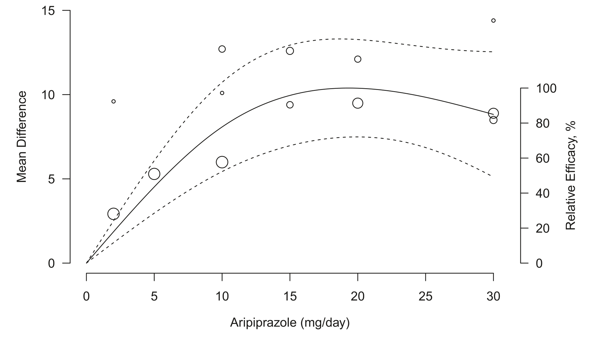
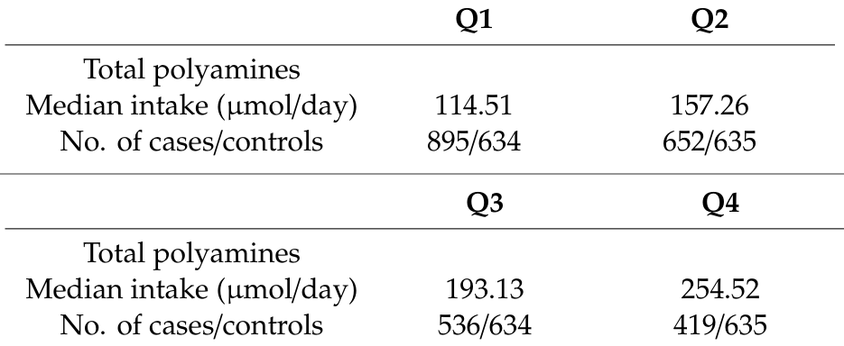
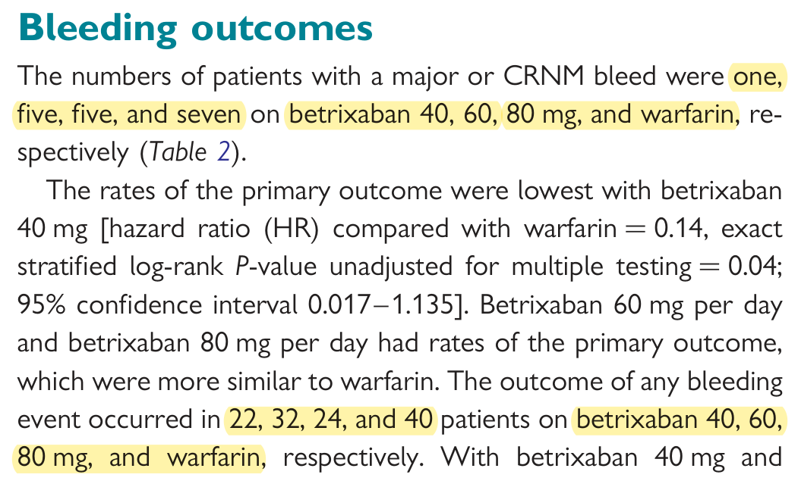
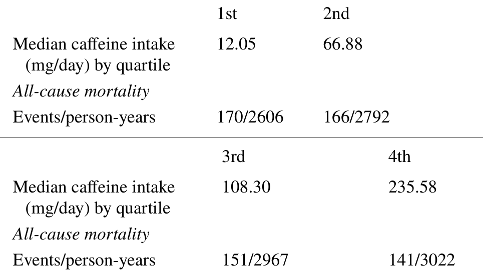
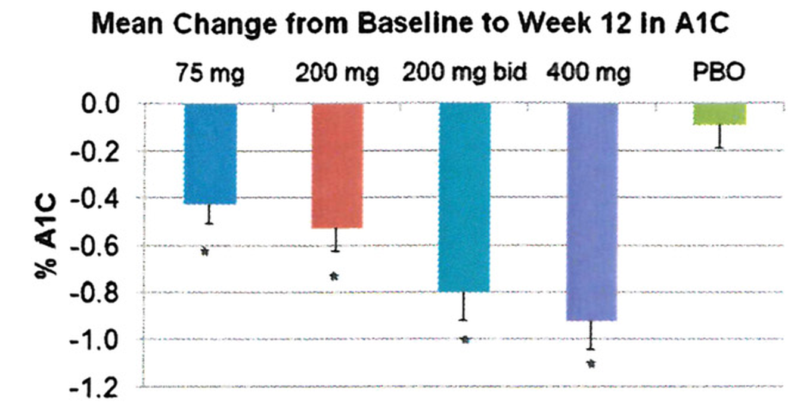

# Viability, search strategy and data extraction {#sec-viability}

```{r}
#| include: false
library(easyDR)
knitr::opts_chunk$set(collapse = FALSE, comment = "")
# Measured, not guessed: the output column fits 69 monospace characters at
# this font size. R gets a little less than that so nothing reaches the edge,
# and R wraps its own columns, which keeps them aligned. Never let CSS wrap
# this text: alignment is the information.
options(width = 66)
```

By now we know what a dose-response meta-analysis answers and what shapes a
curve can take. That was Chapter 1, and it was entirely about the question. This
chapter is about whether the literature will let us ask it.

Most dose-response meta-analyses fail here rather than at the model. The model
is a solved problem, and good software will fit something to almost anything we
hand it. The hard part comes earlier: finding enough studies that report enough
dose levels in enough detail, and noticing that we do not have them before we
have spent three months extracting. The chapter follows the five items of the
class agenda. We first assess viability, then run the check on a practical
example, build the search, extract real studies, and finally prepare the data
in the template that **{easyDR}** reads.

::: {.callout-note appearance="simple"}
**The data in this chapter**

Every data set in this book lives in one Excel workbook,
[`easydr-data.xlsx`](data/easydr-data.xlsx), the same file the 4.1.4 class
uses. Each sheet holds one meta-analysis, and the sheet name is the name we
use in _R_. Two sheets carry this chapter.

`Crippa_2016_aripiprazole` holds five fixed-dose trials of aripiprazole in
schizophrenia, with the improvement on the Positive and Negative Syndrome
Scale (PANSS) reported as a mean and a standard deviation per dose arm. It is
the data behind Crippa and Orsini [-@crippa2016], and the same rows ship with
the **{dosresmeta}** package as `ari`.

`Larsson_2011` holds the cohorts of coffee consumption and stroke pooled by
Larsson and Orsini (Larsson, 2011; Coffee consumption and risk of stroke: a
dose-response meta-analysis of prospective studies; 10.1093/aje/kwr226),
reported as a relative risk with its confidence limits plus the cases and
totals per category.

We read every sheet into one list, `ma`:

```{r}
library(easyDR)
library(readxl)

# Read every sheet of the workbook into a list named after the sheets
myfile      <- "data/easydr-data.xlsx"
sheet_names <- excel_sheets(myfile)
ma <- lapply(sheet_names, function(x) {
  as.data.frame(read_excel(myfile, sheet = x))
})
names(ma) <- sheet_names
```

Chapter 4 shows the same import with a file picker, so the path is never
typed by hand.
:::

## Viability assessment

A dose-response meta-analysis is **viable** when the published literature
contains enough structured information to estimate a trend, not merely to
compare a high group against a low group. This is the same viability we
already learned in MetaRank 1 (Domain Viability, class 1.1.2, "True viability
assessment"), applied to a dose-response question. It asks for more than an
ordinary meta-analysis does, and it is worth being precise about it before
any screening begins.

### Three studies, three doses, a preliminary result

The class puts the whole assessment into three checks: enough studies, enough
doses per study, and data we can actually pool. Let us restate them as steps
we can run against a real extraction sheet, and run each one on both examples
as we go.

#### Step 1. Three studies asking the same question

Three studies, assessing the same intervention or exposure, in the same
population, against the same outcome. This is a MetaHub rule of thumb, not a
statistical minimum. Below three, the between-study variance can hardly be
estimated, and the pooled curve becomes an expensive way of drawing one study.

Let us count the studies, and the rows each one contributes.

```{r}
table(ma$Crippa_2016_aripiprazole$studlab)
```

Five trials, each named by its first author and year. The binary example:

```{r}
table(ma$Larsson_2011$studlab)
```

Sixteen labels, and this is the first place where judgement is needed rather
than arithmetic. Larsson 2008 appears three times, and Sugiyama, Leurs and
Mineharu twice each, with a letter after the year. Those are not sixteen
independent papers. They are fewer papers, some of which report separate
groups of the same cohort (men and women, for example) as separate contrasts.

We keep them as separate rows because each contrast has its own reference and
its own dose categories. We must also remember that two contrasts from one
cohort are not independent, and we say so in the limitations. Both examples
clear Step 1, but only one of them clears it without a sentence of
explanation.

::: {.callout-important}
**One study, several contrasts**

A single cohort reporting several exposures, several outcomes, or several
subgroups will often enter the sheet more than once. Counting those rows as
separate studies inflates the apparent evidence. Count **papers** for Step 1,
count **contrasts** for the model, and state the difference in the methods.
:::

#### Step 2. Three doses per study

This is the condition that separates a dose-response review from every other
kind. A study with two exposure groups can tell us whether high differs from
low. It cannot tell us the shape of anything, because two points define a line
and leave nothing over to test it with.

Three levels means the reference and two doses. That is enough for a
two-stage restricted cubic spline, the model we will meet in Chapter 4. An
Emax curve, which rises and then levels off, needs **four** levels. The tables
we just printed count the levels: every aripiprazole trial reports three or
four dose arms, and every coffee cohort reports between three and six intake
categories. Both examples pass, which is not the usual experience. In most
searches this is the step that removes half the hits.

#### Step 3. A usable reference in every study

Every study needs one level that the others are expressed against. It is
often placebo or never-exposed, and it does not have to be. The lowest dose a
study reports will serve, though a placebo or a zero dose pools more easily
because every study then shares the same starting point.

In the workbook the reference row is the one with `TE` = 1 and empty limits,
and **{easyDR}** finds it on its own. Let us check that each coffee cohort has
exactly one:

```{r}
with(ma$Larsson_2011, tapply(TE == 1 & is.na(lower), studlab, sum))
```

One apiece. A continuous sheet carries no `TE`, so **{easyDR}** takes each
study's lowest dose as its reference, which here is the placebo arm at
0 mg/day. When studies disagree about what the reference should be, and they
usually do, the estimates have to be re-expressed against a common reference
before pooling [@hamling2008]. That is a Chapter 4 problem. At this stage we
only need to know that a reference exists.

#### Step 4. Enough reported per level to reconstruct the covariance

Here is the step that is invisible until we try to extract, and it is the one
that sinks most reviews.

The levels within a study are all compared against the same reference, so
their effects are correlated. Treating them as independent would give a
confidence interval that is too narrow, so the within-study covariance has to
be reconstructed. **{easyDR}** calls **{dosresmeta}**, which does this with the
method of Greenland and Longnecker [-@greenland1992]. The method needs more
than the effect estimate: it needs the counts, or the means with their
standard deviations, behind each level.

For continuous data we need a mean, a standard deviation and an n per level:

```{r}
head(ma$Crippa_2016_aripiprazole, 4)
```

`mean`, `sd` and `n` are all present, so the continuous example is complete.
For binary data we need the cases and totals, with the effect and its limits
wherever the paper reports them:

```{r}
head(ma$Larsson_2011, 4)
```

`event` and `n`, then `TE` with `lower` and `upper`. We see that the reference
row carries `TE` = 1 and no limits, which is correct: the reference is the
comparator, not an estimate.

::: {.callout-important}
**The step that ends reviews**

A paper may report a beautiful table of odds ratios per quintile and never
print the number of cases in each quintile. Without the counts, the covariance
cannot be reconstructed, and the study cannot enter a two-stage model.

This chapter lost an example to exactly this. The class first used Furukawa
and colleagues [-@furukawa2019] as a binary illustration. That paper pools 77
trials, and its supplementary appendix lists, for every treatment arm, the
drug, the dose delivered and the number randomised. It never lists how many of
them responded. The dose is there, the denominator is there, and the numerator
is not, so no amount of care at the extraction stage can rescue it.

Check this on three or four candidate papers before committing to a question.
:::

#### Step 5. Extract, and run a preliminary result

The final check is empirical. Extract what you have and run a first
dose-response curve before committing further. A sheet that passes the first
four steps on paper may still fail when a model touches it, usually because
of a dose that does not increase, a duplicated reference, or a level with an
impossible standard deviation.

The point of fitting here is not to learn anything about aripiprazole or
coffee. It is to confirm that the data can carry a model at all.

```{r}
easydr.object.cont <- easydr(data      = ma$Crippa_2016_aripiprazole,
                             sm        = "MD",
                             shape     = "linear",
                             dose.unit = "mg/day")
easydr.object.cont
```

There is a lot in that output, and almost all of it belongs to Chapter 4. For
now we only check that all five trials entered, and that the estimate is
finite with a usable interval. The data carries a model.

```{r}
easydr.object.bin <- easydr(data      = ma$Larsson_2011,
                            sm        = "RR",
                            shape     = "linear",
                            dose.unit = "cups/day")
easydr.object.bin
```

Again all sixteen contrasts entered, with a finite estimate and a usable
interval. We see the same structure as before, on data of a different kind.
The `type` column says that twelve contrasts are incidence rates and four are
cumulative incidence, and each keeps its own covariance approximation. That is
something to carry into a sensitivity analysis by design, not a failure.

Notice what the package did not do. It refused to choose a shape for us:
asking for a fit without naming `shape` produces an error, not a default,
because the shape is a claim about biology and belongs in the protocol. We
asked for `"linear"` deliberately, as the simplest thing that could possibly
fit, and we are deliberately not reading the slope. Whether the relationship
is linear, and what it means if it is not, is Chapter 4.

### Two-stage and one-stage models

Viability counts only the studies that the primary model can use. To see why,
we need the two ways of pooling a dose-response relationship.

The **two-stage** approach fits a curve inside each study, then pools the
curves. Each study needs enough levels to carry its own curve, which for a
spline means three or more: the reference and two doses. In return it gives
us each study's own curve, the Q test and $I^2$.

The **one-stage** approach fits one model to the data of every study at once
[@crippa2019]. Studies with only two exposure levels stay in, because the
curve is estimated across studies rather than inside each one.

::: {.callout-note appearance="simple"}
**Which model is primary?**

**Default.** Use the two-stage model as the primary analysis, and count for
viability only the studies with 3 or more exposure levels (the reference and
2 doses).

**When the default fails.** If some studies report only 2 exposure levels,
keep the two-stage model as primary and run the one-stage model as a
sensitivity analysis that includes them, to check that leaving them out did
not change the curve. If the review is viable only through the one-stage
model, it is not viable. Crippa, 2019; One-stage dose-response meta-analysis
for aggregated data; 10.1177/0962280218773122
:::

Let us see what this rule does to a sheet. The workbook carries a second
version of the coffee data, `Larsson_2011_2levels`, in which some cohorts
report only two categories:

```{r}
levels.per.study <- table(ma$Larsson_2011_2levels$studlab)
levels.per.study[levels.per.study < 3]
sum(levels.per.study >= 3)
```

We see that three contrasts (Silletta 2007 and both Sugiyama 2010 groups)
report two levels. They are left out of the two-stage model and kept in the
one-stage sensitivity analysis, and thirteen contrasts count towards
viability.

Published reviews show the same split. Di Giuseppe and colleagues had seven
studies in their linear analysis and six in the spline, because one study
reported only a linear trend (Di Giuseppe, 2014; Fish consumption and risk of
rheumatoid arthritis: a dose-response meta-analysis;
10.1186/s13075-014-0446-8). Chapter 4 fits both models in code.

::: {.callout-note appearance="simple"}
**Reporting it**

The viability assessment belongs in the methods, in two or three sentences. A
version to adapt:

> *We required that at least three studies assess the same exposure in the
> same population against the same outcome. For the primary two-stage
> analysis, each study had to report at least three quantitative exposure
> categories, including the reference category. For each category we
> extracted the number of events and the total, together with the adjusted
> effect estimate and its confidence limits where reported, which are
> required to reconstruct the within-study covariance of the estimates.
> Studies reporting two categories were included in a one-stage sensitivity
> analysis.*
:::

## Practical example

Having run the steps, let us look at the example the class follows, the
aripiprazole meta-analysis we already met in Chapter 1.

### The aripiprazole trials

```{r}
#| label: tbl-examples
#| tbl-cap: "The practical example of this chapter."
knitr::kable(data.frame(
  `Author, Year`    = "Crippa and Orsini, 2016",
  Population        = "Schizophrenia or psychotic disorder",
  Intervention      = "Aripiprazole",
  `Available doses` = "0 (placebo), 2, 5, 10, 15, 20, 30 mg/day",
  check.names = FALSE
))
```

The extraction table is one row per dose arm, five trials and eighteen rows,
with the placebo arm first in every trial as its reference:

```{r}
ma$Crippa_2016_aripiprazole
```

We see three trials with four arms and two with three, so every trial clears
Step 2. This is the table behind the curve the paper reports.

{#fig-crippa-fig2}

Our own preliminary fit cannot reproduce that figure yet, and it should not
try: the spline and its knots are Chapter 4. What it can do is settle
viability, and two figures do that. They are the only two worth drawing at
this stage: the forest plot of the levels, and the curve fitted through them.

```{r}
#| label: fig-forest-cont
#| fig-cap: "Aripiprazole: every dose arm against its trial's placebo arm."
#| fig-width: 8
#| fig-height: 4.6
easydr_forest(easydr.object.cont)
```

```{r}
#| label: fig-curve-cont
#| fig-cap: "Aripiprazole: the preliminary linear fit with its confidence band."
#| fig-width: 7
#| fig-height: 4.4
easydr_curve(easydr.object.cont)
```

We see one row per trial, and beside each one the two numbers Steps 2 and 3
asked for: how many dose levels it reported, and the range those levels span.
Then a curve across the observed range with a band that stays finite. The
levels are there, they are spread across the dose range, and the model has
something to fit.

#### The binary example

The same pair for the coffee and stroke cohorts:

```{r}
#| label: fig-forest-bin
#| fig-cap: "Coffee and stroke: every category against its cohort's reference."
#| fig-width: 8
#| fig-height: 6
easydr_forest(easydr.object.bin)
```

```{r}
#| label: fig-curve-bin
#| fig-cap: "Coffee and stroke: the preliminary linear fit with its confidence band."
#| fig-width: 7
#| fig-height: 4.4
easydr_curve(easydr.object.bin)
```

The two examples differ in nearly every way that matters to the model. One is
a set of randomised trials with a true placebo arm, the other a set of cohorts
where the reference is the lowest reported intake. One reports a continuous
outcome as a mean and a standard deviation, the other a ratio with counts
behind it. Yet both answer the viability question the same way. The forest
gives the dose levels and the dose range for every study, and the curve shows
whether those levels span enough of the range for a trend to mean anything. A
forest with a study reporting two levels, or a curve whose band swallows the
whole plot, is a review that should stop here rather than at the write-up.

## Search strategy

A dose-response search is narrower than it looks, and the most common mistake
is to make it wider.

### Population AND intervention

You build one central strategy, from two concepts only:

> **(Population) AND (Intervention)**

The **population** is the group of patients or subjects under study. The
**intervention** is the dose-varying exposure or treatment itself. Nothing
about the dose goes into the string: a paper rarely names its dose levels in
the title or abstract, and you will judge them at full-text screening.

The three examples from Chapter 1 show the pattern. The strings are
illustrative, not the ones the authors published:

```{r}
#| label: tbl-search
#| tbl-cap: "The two search concepts, for the three examples of Chapter 1. Illustrative strings."
knitr::kable(data.frame(
  Example      = c("Crippa and Orsini, 2016", "Furukawa et al., 2019", "JAMA, 2024"),
  Population   = c('("schizophrenia" OR "psychotic disorder")',
                   '("major depressive disorder" OR "depression")',
                   '("adults" OR "exercise trial")'),
  Intervention = c('("aripiprazole")',
                   '("SSRI" OR named agents)',
                   '("aerobic exercise" OR "physical activity")')
))
```

Two further rules are worth carrying into the protocol.

- **Leave the outcome out of the search strategy.** This is a MetaHub
  recommendation. In an ordinary review the outcome is a useful filter; here
  it only narrows your results and hides studies you could still pool. Papers
  report several outcomes, abstracts mention few of them, and a study with
  four dose arms is worth retrieving whether or not its abstract names your
  outcome. Filter on outcome at full-text screening, where you can see the
  dose table.
- **Add placebo as a control arm only if you include RCTs exclusively.** For a
  trials-only review, a placebo or control concept is a reasonable way to find
  fixed-dose designs. For an observational review it excludes most of the
  literature, because cohorts do not describe their reference category that
  way.

## Data extraction

Extraction happens before _R_ ever sees the data, and it is where the dose
table of each paper becomes rows in your sheet.

### Real studies, from a table, the text or a plot

The class works through four real studies, each with three doses or more:
three binary ones, one for each value of the `type` column, and one
continuous. Each crop below is the paper's own table, text or plot, and the
rows under it are what you type into the template.

#### Case-control, from a table (`cc`)

{#fig-extract-cc}

| dose | event | n |
|---:|---:|---:|
| 114.51 | 895 | 1,529 |
| 157.26 | 652 | 1,287 |
| 193.13 | 536 | 1,170 |
| 254.52 | 419 | 1,054 |

The dose is the median intake per quartile in µmol/day, and the lowest
quartile is the reference. In a case-control study `n` is cases plus
controls. Extract the adjusted odds ratio and its 95% confidence interval as
well, into `TE`, `lower` and `upper`.

#### Cumulative incidence, from the text (`ci`)

{#fig-extract-ci}

| dose | event | n |
|---:|---:|---:|
| 40 | 22 | 127 |
| 60 | 32 | 127 |
| 80 | 24 | 127 |

The outcome is any bleeding, the dose is betrixaban in mg/day, and the lowest
dose is the reference. The warfarin arm is left out: another drug is not on
the betrixaban dose scale, so it cannot be a level of this exposure.

#### Incidence rate, from a table (`ir`)

{#fig-extract-ir}

| dose | event | n |
|---:|---:|---:|
| 12.05 | 170 | 2,606 |
| 66.88 | 166 | 2,792 |
| 108.30 | 151 | 2,967 |
| 235.58 | 141 | 3,022 |

The dose is the median caffeine intake per quartile in mg/day, the events are
all-cause deaths, and `n` is person-years. The lowest quartile is the
reference.

#### Continuous, from a plot

{#fig-extract-cont}

| dose | mean | sd | n |
|---:|---:|---:|---:|
| 0 | -0.09 | 0.77 | 60 |
| 75 | -0.42 | 0.69 | 59 |
| 200 | -0.52 | 0.77 | 60 |
| 400 | -0.92 | 0.93 | 60 |

The outcome is the change in A1C (%), the dose is in mg/day, and the placebo
arm is the reference. The means come from the text. The plot gives only the
standard error, so you read it off the figure and convert it:
$sd = SE \times \sqrt{n}$.

::: {.callout-important}
**Dose ranges**

Use the median or mean dose the paper reports for each category. When it
gives only a range, assign the midpoint. An open lowest range starts at zero,
and an open highest range takes the width of the range below it (Di Giuseppe,
2014; Fish consumption and risk of rheumatoid arthritis: a dose-response
meta-analysis; 10.1186/s13075-014-0446-8).
:::

## Data preparation

Once the rows exist, they go into one of two templates, depending on the
nature of your data. The column names are the ones **{easyDR}** reads, so the
sheet goes into _R_ without any renaming.

### The binary and continuous templates

The binary template holds one row per category per study:

{#fig-template-binary}

The `type` column records the study design, and it is not decoration. It
changes how the covariance between the doses of a study is calculated, and it
changes what `n` means:

| `type` | Design | Example | `n` is |
|---|---|---|---|
| `cc` | Case-control | 61 cases among 261 people | cases + controls |
| `ci` | Cumulative incidence | 229 events in 975 people followed | people |
| `ir` | Incidence rate | 2,944 events in 3,790,943 person-years | person-years |

Because the type sets the covariance, designs can be pooled together, but
always run a sensitivity analysis by design.

Fill either `event` and `n`, or `TE`, `lower` and `upper`, and both whenever
you can. `TE` is for the adjusted relative risk or odds ratio with its 95%
confidence interval whenever a study reports it, and **{easyDR}** pools `TE`
when it is present. A study that gives only one of the two leaves the other
columns empty.

The continuous template holds one row per dose arm, with the mean, its
standard deviation and the number of participants:

{#fig-template-continuous}

Whichever template you use, the sheet carries the same obligations:

- **One row per dose level per study.** Never one row per study.
- **A numeric dose**, on one scale, converted at extraction rather than later.
- **One reference row per study.** In the binary template it is the row with
  `TE` = 1 and `lower` and `upper` empty, with its `n` still filled in. There
  is no reference column; **{easyDR}** finds the row.
- **Raw values, never logs.** Type the ratio and its limits as the paper
  prints them. **{dosresmeta}** takes the logarithm itself.
- **Column names exactly as in the template.** Any extra column, such as the
  `nordic` column of `Larsson_2011`, holds a subgroup for later.
- **One sheet per analysis.** The sheet name is the name you use in _R_.

Everything else in a dose-response meta-analysis can be fixed afterwards.
These cannot, because the information is in the paper and not in the sheet,
and going back to 70 PDFs to add a column is the most expensive hour in this
method.

::: {.callout-note appearance="simple"}
**Test your knowledge!**

1. A review finds four cohort studies of coffee and stroke. Three report four
   intake categories each; the fourth reports only "any" against "none". Is the
   review viable, and which analysis can the fourth study still enter?
2. A paper reports hazard ratios with confidence intervals for five intake
   quintiles, but gives the number of events only as a total across all
   quintiles. Which step does it fail, and why can it not be fixed at the
   extraction stage?
3. Why does the outcome stay out of the search string in a dose-response
   review, when it is routinely included in an ordinary one?
4. A cohort reports intake categories of "less than 1", "1 to 3" and "more than
   3" cups per day. Which doses do you type into the `dose` column?

Answers to these questions are listed in Appendix A.
:::

## Summary

- A dose-response meta-analysis is viable when the literature carries enough
  structured information to estimate a trend, which is a stronger requirement
  than comparing a high group against a low group.
- The checks are three studies on the same question, three exposure levels per
  study, one usable reference per study, enough reported per level to
  reconstruct the within-study covariance, and a preliminary model that
  actually runs.
- Viability counts only the studies the primary two-stage model can use. A
  study with two levels enters the one-stage sensitivity analysis, and a review
  that is viable only through the one-stage model is not viable.
- A paper can report its effect estimates in full and still omit the counts
  behind them, and no care at the extraction stage recovers a number the
  authors never printed.
- The search is built from population and intervention only. The outcome is
  filtered at full-text screening, where the dose table is visible.
- Doses come from tables, text or plots. Use the reported median or mean, and
  the midpoint when only a range is given.
- The binary template takes `studlab`, `type`, `dose`, `event`, `n`, `TE`,
  `lower` and `upper`, and the continuous template takes `studlab`, `dose`,
  `mean`, `sd` and `n`. The type value (`cc`, `ci` or `ir`) decides how the
  covariance is built and what `n` counts.


